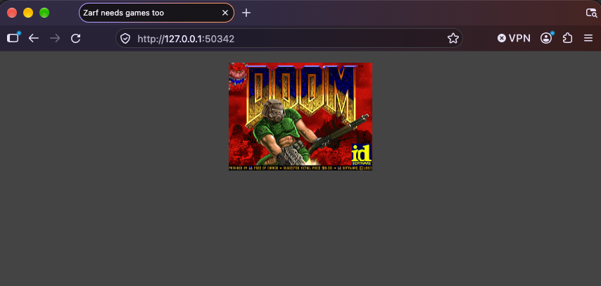

## Introduction

In previous tutorials, we learned how to [create a package](/tutorials/0-creating-a-zarf-package/), [initialize a cluster](/tutorials/1-initializing-a-k8s-cluster/), and [deploy a package](/tutorials/2-deploying-zarf-packages/). In this tutorial, we will leverage all that past work and deploy a fun application onto your cluster.

## System Requirements

- You'll need an internet connection to grab the Zarf Package for the games example.

## Prerequisites

Before beginning this tutorial you will need the following:

- The [Zarf](https://github.com/zarf-dev/zarf) repository cloned: ([git clone instructions](https://docs.github.com/en/repositories/creating-and-managing-repositories/cloning-a-repository))
- Zarf binary installed on your $PATH: ([Installing Zarf](/getting-started/install/))
- [An initialized cluster](/tutorials/1-initializing-a-k8s-cluster/)

## Deploying the Arcade

1. The `dos-games` package is easily deployable via `oci://` by running `zarf package deploy oci://ghcr.io/zarf-dev/packages/dos-games:1.3.0 --key=https://zarf.dev/cosign.pub`.

:::tip

You can publish your own packages for deployment too via `oci://`.  See the [Store and Deploy Packages with OCI](/tutorials/6-publish-and-deploy/) tutorial for more information.

:::

<iframe src="/tutorials/package_deploy_deploy.html" width="100%" height="595px"></iframe>

2. If you did not use the `--confirm` flag to automatically confirm that you want to deploy this package, press `y` for yes.  Then hit the `enter` key.

<iframe src="/tutorials/package_deploy_deploy_bottom.html" width="100%" height="400px"></iframe>

### Connecting to Doom

When the package finishes deploying, Zarf lists two connection shortcuts. Run `zarf connect games` to open the Doom-only launcher, or run `zarf connect doom` to launch Doom directly. The selected command opens the application in your browser using a `zarf connect` tunnel.

<iframe src="/tutorials/package_deploy_connect.html" width="100%"></iframe>

:::note
If your browser doesn't automatically open up, you can manually go to your browser and copy the IP address that the command printed out into the URL bar.
:::

:::note
The `zarf connect games` will continue running in the background until you close the connection by pressing the `ctrl + c` (`control + c` on a mac) in your terminal to terminate the process.
:::

## Removal

1. Use the `zarf package list` command to get a list of the installed packages.  This will give you the name of the games package to remove it.

<iframe src="/tutorials/package_deploy_list.html" height="120px" width="100%"></iframe>

2. Use the `zarf package remove` command to remove the `dos-games` package.  Before the package is removed, Zarf displays the package definition and asks you to confirm.

<iframe src="/tutorials/package_deploy_remove_no_confirm.html" width="100%" height="425px"></iframe>

The dos-games package has now been removed from your cluster.

## Troubleshooting

### Unable to connect to the Kubernetes cluster

<iframe src="/tutorials/troubleshoot_unreachable.html" width="100%" height="200px"></iframe>

:::note[Remediation]

If you receive this error, either you don't have a Kubernetes cluster, your cluster is down, or your cluster is unreachable.

1. Check your kubectl configuration, then try again.  For more information about kubectl configuration see [Configure Access to Multiple Clusters](https://kubernetes.io/docs/tasks/access-application-cluster/configure-access-multiple-clusters/) from the Kubernetes documentation.

If you need to setup a cluster, you can perform the following.

1. Deploy a Kubernetes cluster with the [Creating a K8s Cluster with Zarf](/tutorials/4-creating-a-k8s-cluster-with-zarf/) tutorial.
2. Perform the [Initialize a cluster](/tutorials/1-initializing-a-k8s-cluster/) tutorial.

After that you can try deploying the package again.

:::

### Secrets "zarf-state" not found

<iframe src="/tutorials/troubleshoot_uninitialized.html" width="100%" height="250px"></iframe>

:::note[Remediation]

If you receive this error when zarf is attempting to deploy the `BASELINE COMPONENT`, this means you have not initialized the kubernetes cluster.  This is one of the prerequisites for this tutorial.  Perform the [Initialize a cluster](/tutorials/1-initializing-a-k8s-cluster/) tutorial, then try again.

:::

## Credits

:sparkles: Special thanks to these fine references! :sparkles:

- [reddit.com/r/programming/comments/nap4pt/dos_gaming_in_docker](https://www.reddit.com/r/programming/comments/nap4pt/dos_gaming_in_docker/)
- [earthly.dev/blog/dos-gaming-in-docker](https://earthly.dev/blog/dos-gaming-in-docker/)
